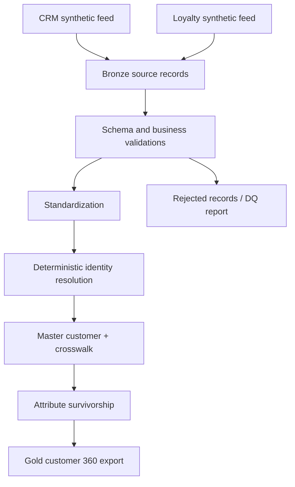

# Customer 360 | Enterprise Data Architecture Portfolio

**Portfolio status:** Phase 1 runnable local proof of concept. **Data:** 100% synthetic. **Not a copy of any employer's systems.**

A hands-on, testable data architecture case study demonstrating canonical entity modeling, source-to-target mapping, deterministic identity resolution, attribute survivorship, data quality gates, and lineage. Built as a local-first foundation for a future Databricks/Delta Lake + AI extension.

## The business problem
Five conceptual business domains (CRM, commerce, loyalty, returns, marketplace) use different customer identifiers and formats. The goal is to create a traceable enterprise customer view while minimizing duplicate masters and false merges.

## Architecture (phase 1)



> This is a reproducible, demonstrative architecture, not an assertion that the same exact pipeline ran at a former employer. Names and metrics from professional experience are intentionally omitted.

## Quickstart
Requirements: Python 3.10+.

```bash
python -m pip install -e '.[dev]'
python -m pytest -q
python -m customer360.pipeline
```

Outputs are written to `output/` (gitignored): `customer_master.csv`, `source_crosswalk.csv`, `data_quality_report.json`.

## What to inspect
- `docs/requirements.md` — business requirements and non-functional requirements
- `docs/data_model.md` — grain, entity model and PK/FK definitions
- `docs/source_to_target_mapping.md` — transformation contracts
- `docs/adr/0001-identity-design.md` — architecture decision with rejected alternatives
- `docs/adr/0002-survivorship.md` — attribute precedence and limitations
- `src/customer360/pipeline.py` — working canonicalization, identity matching and gold exports
- `tests/` — reproducible architecture behavior tests
- `docs/roadmap.md` — deployment, incremental pipelines, vector matching and observability roadmap

## Engineering principles
1. Preserve source keys and source lineage; never use email as the enterprise master key.
2. Do not merge based on fuzzy names alone.
3. Validate input data and record rejected rows.
4. Explicitly label deterministic demonstration rules and failure cases.
5. Treat compliance, scale, and accuracy as goals requiring evidence—not marketing claims.

## Status and limits
Current implementation reads only two synthetic feeds, operates in batch, and resolves identity through verified exact email matches (not fuzzy MDM). It does not yet run on Databricks, use Spark/Delta, or implement real agentic AI. Ambiguous and shared identities are material limitations and are addressed in the roadmap.

## Interview pitch (30 seconds)
> I designed a reproducible Customer 360 architecture starting with source contracts and entity grain, then implemented ingestion validation, canonicalization, conservative cross-source identity matching, golden-record survivorship, and lineage exports. I documented trade-offs through ADRs and verified critical failure cases with tests. The next milestone is incremental Delta Lake processing with monitoring and review-based matching.

## Safety
Synthetic data only. No actual payment, customer, employer or credential data. Never commit API keys or confidential diagrams.

If you already have `pytest` installed and do not want to install the package, you can run:

```bash
PYTHONPATH=src python -m pytest -q
PYTHONPATH=src python -m customer360.pipeline
```

On Windows PowerShell, set `$env:PYTHONPATH="src"` before these commands.
