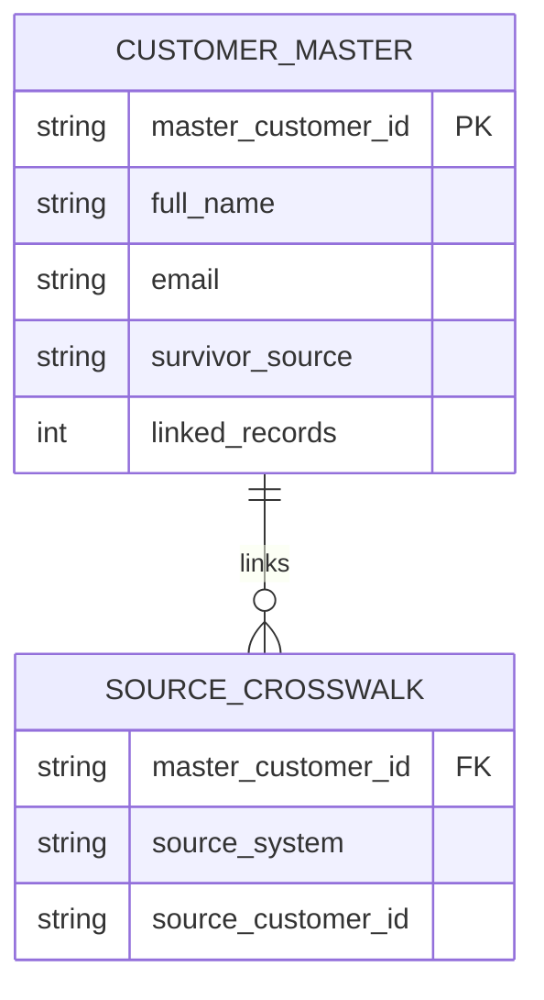

# Logical data model

**Grain:** `customer_master` has one row per phase-1 resolved normalized email. `source_crosswalk` has one row per accepted source customer record.

**Business key of crosswalk:** `(source_system, source_customer_id)`.

**Important caveat:** master ID uses SHA-256 of normalized email in this demo. This is deterministic for reruns, but is **not** suitable as a production enterprise ID because changing/reassigned emails would change or conflate identities. Production proposal: immutable generated surrogate IDs and an independent, auditable matching history.
